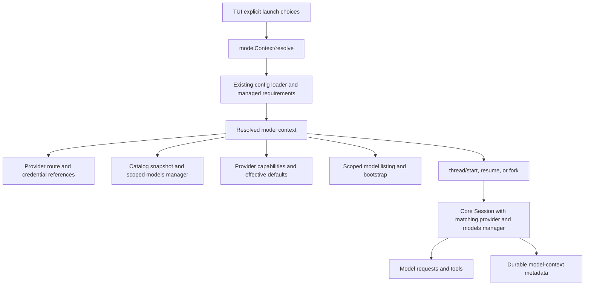

# Mixed Provider App Server

Status: implemented with selected local qualification passed; evidence and remaining live/platform gates are tracked in [the validation record](mixed-provider-app-server-validation.md). This is not a production acceptance claim.

Date: 2026-10-27. Examined source baseline: `91876a35008ee2ed7efedb62c2519a0105f09482`, branch `multi_agent_v2_custom_provider`.

## Objective

Allow multiple Codex clients to use one shared app-server while independently selecting a provider, model, and model catalog. A thread's model picker, capabilities, request construction, and execution must agree on that selection.

The motivating invocation must attach to the existing local daemon and create a Kimi thread:

```sh
codex \
  -c 'model_provider="kimi"' \
  -c 'model_catalog_json="~/.codex/models_kimi.json"' \
  -m k3.1-pro
```

A second terminal running plain `codex` must continue to use the server's defaults. Neither invocation may restart the daemon, rewrite global configuration, or replace another thread's model catalog merely to select its own model context.

This is more than accepting a different endpoint. Model metadata can influence instructions, reasoning options, context accounting, compaction thresholds, tool schemas, and request parameters. Routing to one provider while consulting another provider's metadata is a correctness failure.

## Current implementation and gaps

The following observations describe the examined checkout, not the proposed behavior.

| Layer | Current behavior | Gap |
| --- | --- | --- |
| CLI daemon eligibility | `config_exclusion` permits a narrow set of CLI overrides. Provider and catalog overrides are excluded. | The motivating command skips implicit shared-daemon reuse and uses embedded mode. |
| Thread API | `thread/start` accepts `model` and `modelProvider`; resume and fork also expose model/provider choices. | These fields alone do not establish complete discovery and catalog isolation. |
| TUI bootstrap | Calls `model/list` before starting a thread. | The request has pagination/visibility fields but no provider, context, or thread selector. |
| Catalog service | `ModelCatalog` retains one current effective configuration and models manager, with invalidation on account transitions. | Discovery operates against the server's default catalog snapshot. |
| TUI config forwarding | Forwards an allowlist of session flags. | `model_catalog_json` is omitted. |
| Core startup | `ThreadManager` supplies its shared models manager to `Session::spawn`. | Forwarding a different catalog path does not replace that runtime manager. |
| Configuration contract | `model_catalog_json` is documented as startup-only; per-thread overrides are no-ops. | Changing this contract requires runtime and API work, not just CLI allowlisting. |
| Credential environment | The daemon uses the environment inherited at its own startup. | A credential in a newly launched TUI's shell is not automatically available to the daemon. |

Relevant implementation:

- [Daemon selection](../../codex-rs/tui/src/startup_orchestration.rs) and [override exclusions](../../codex-rs/tui/src/daemon_startup.rs).
- [TUI bootstrap and configuration forwarding](../../codex-rs/tui/src/app_server_session.rs), [explicit launch choices](../../codex-rs/tui/src/app_server_session/startup_launch.rs), and [provider selection](../../codex-rs/tui/src/app_server_session/provider_selection.rs).
- [Thread request schemas](../../codex-rs/app-server-protocol/src/protocol/v2/thread.rs) and [model schemas](../../codex-rs/app-server-protocol/src/protocol/v2/model.rs).
- [Default catalog service](../../codex-rs/app-server/src/model_catalog.rs), [catalog processor](../../codex-rs/app-server/src/request_processors/catalog_processor.rs), and [provider capability reads](../../codex-rs/app-server/src/request_processors/config_processor.rs).
- [Thread manager and models-manager construction](../../codex-rs/core/src/thread_manager.rs), [core session startup](../../codex-rs/core/src/session/mod.rs), and [provider factory](../../codex-rs/model-provider/src/provider.rs).
- [Catalog configuration](../../codex-rs/config/src/config_toml.rs), [catalog loading](../../codex-rs/core/src/config/mod.rs), and [daemon environment contract](../../codex-rs/app-server-daemon/README.md).

The configuration path type supports home-directory expansion. The quoted `~` in the example is not the daemon exclusion cause; see [AbsolutePathBuf](../../codex-rs/utils/absolute-path/src/lib.rs).

## Scope

The first release supports:

- A local shared daemon with several TUI connections and threads.
- Independent provider/model/catalog selections, including different catalogs for the same provider and identical model slugs under different providers.
- Static JSON catalogs and provider-native model discovery.
- Scoped model listing, provider capabilities, model switching, thread creation, resume, ordinary forks, and sub-agent creation.
- Existing embedded and legacy API behavior when the new capability is not used.
- Server-side resolution of configured providers and credentials.

The first release does not add:

- Per-client environment or credential forwarding, caller-supplied provider definitions, or separate accounts for every thread.
- Remote catalog upload or interpretation of a client-local path on another host.
- A provider migration or history-translation engine. Existing cross-provider history and plaintext collaboration restrictions remain authoritative.
- General support for all CLI overrides against the daemon, or a new profile-selection feature.
- A change to the executor, sandbox, permission, network-policy, or approval authority selected by the host.

## Invariants

1. A core session obtains provider routing and model metadata from one resolved model context.
2. Changing one client's selection does not mutate the daemon defaults or another thread's context.
3. An explicit custom catalog is loaded and validated once during context resolution. Discovery and thread startup consume that exact parsed snapshot.
4. A model slug is never a sufficient cache or runtime identity. Provider, catalog, authentication scope, and relevant feature settings participate in identity.
5. Current managed requirements and application network policy remain authoritative, including when metadata is cached.
6. A context ID selects server state; it does not authorize access. Connection identity and existing thread access checks remain authoritative.
7. Resolved credentials are not returned to clients, recorded in context metadata, or written to diagnostic logs.
8. Unsupported selection, expired context, catalog failure, and route conflict are explicit failures. The server does not silently choose another provider or fall back to unrelated metadata.
9. Existing plaintext task encoding, recipient projection, delivery scheduling, and durable collaboration mode are preserved.

## Architecture

Introduce a server-owned `ModelContextRegistry` and a core-level `ResolvedModelContext`. The registry manages pending contexts and connects API requests to resolved core state. Core must not depend on app-server connection IDs or protocol request types.



The existing `ModelCatalog` remains the default context facade for unscoped requests. Account transitions and the default background refresh worker continue to operate on that default. Scoped requests must not temporarily change its current configuration to answer another client.

### Ownership

| Scope | State |
| --- | --- |
| Server | Registry, configured provider definitions, credential services, default context, current policy, execution services. |
| Connection | Pending-context handles, explicit launch choices, bootstrap and model-list request state. |
| Thread | Retained resolved context, mutable selected model/settings, history, durable context reference. |
| Turn | Effective model and settings, pinned model-info snapshot, provider request, tools and output. |

`ResolvedModelContext` contains:

- Effective provider ID and provider configuration, held in memory under existing secret-handling rules.
- References to server-owned credential services, never a copied credential payload for a client.
- Catalog source: configured file snapshot, provider-native discovery, or the provider's existing bundled/default strategy.
- Parsed static catalog and a digest where applicable.
- The provider constructed from that configuration and its `SharedModelsManager`.
- Effective provider capabilities and configuration provenance required for policy checks.

The model selected for a thread is stored separately from context identity. This permits a model switch within one provider/catalog without changing the thread's route. The resolver validates the requested initial model and returns the effective selection alongside the context.

Reusing a matching context does not waive model membership checks. Validate static selections at child-role preparation and core startup as well as public API boundaries; preserve only the caller's existing explicit fallback controls.

## Configuration resolution

Use the existing configuration layer loader and authority rules. Do not implement an independent precedence algorithm inside the registry.

For a new thread, resolve its host/session/project configuration, then the admitted invocation choices, subject to existing higher-authority session sources and managed requirements. Supplying a context must not promote caller input to host or managed authority.

Record explicit launch choices before loading local defaults, extending `StartupLaunchChoices` to include the catalog source. An omitted CLI option must remain omitted in the RPC; a locally resolved default must not accidentally replace the daemon's default.

The resolver accepts a narrow typed payload rather than arbitrary TOML or provider definitions. Existing non-model thread configuration continues through its current path. The effective working directory and model-related configuration must agree between resolution and thread startup; conflicting values fail instead of reinterpreting an already resolved context.

If managed settings require another provider or catalog, retain the existing precedence behavior and report the effective values and the override's origin. Policy violations that cannot be satisfied fail before provider discovery or thread creation. A managed catalog must not be bypassed by restoring a caller's saved snapshot.

### Catalog binding and validation

- A CLI catalog path is resolved on the server host. For local daemon launches, normalize it using the same base-directory and home-expansion semantics as the existing configuration loader.
- This first release admits client-supplied catalog paths only through authenticated local connections, including embedded mode. Remote clients may use host-configured sources and authorized thread contexts; catalog uploads are deferred.
- Read the file with a bounded read, parse the existing `ModelsResponse` schema, and reject an empty catalog, duplicate model slugs, malformed metadata, and invalid model constraints.
- Proposed feature-specific limits: 8 MiB serialized catalog, 2,048 models, and 64 KiB per base or persistent instruction string. Validate the rest of the model fields using existing constraints. These new bounds apply to the new context path; changing legacy loader limits requires separate compatibility review.
- Compute a digest from a versioned canonical encoding of the validated catalog. Preserve the original path as provenance, not as the runtime authority after resolution.
- Do not reread a static catalog during thread startup, picker refresh, or a turn. A new invocation can resolve a new snapshot after the file changes.
- Bind a catalog to its resolved provider. A global startup catalog belongs to the provider selected with it; it is not a generic fallback for another provider.
- Static catalog presence alone does not establish that a remote provider accepts its advertised capabilities. Live compatibility remains a separate gate.

For provider-native discovery, the context pins provider configuration and discovery strategy, not an eternally immutable remote catalog. Retain existing refresh behavior within that scope. Pin model information for the duration of a turn and version list snapshots so refresh cannot corrupt pagination.

The effective API-key discovery setting participates in runtime context compatibility. Reject a conflicting attachment override before provider I/O, and compare effective configuration only after runtime feature defaults are applied. Internal derivation that changes discovery settings must create an isolated manager rather than mutate another thread's manager.

## Protocol

The interfaces in this section are implemented by this feature. The baseline observations above describe the pre-feature checkout.

### Capability negotiation

Add an optional `serverCapabilities` object to `InitializeResponse` and advertise `serverCapabilities.mixedProviderAppServer: 1`. The current response has no server-capability object; this is an additive protocol extension, distinct from the client's existing `InitializeCapabilities`. Version `1` means that resolution, scoped discovery, per-session execution, and durable context restoration are all supported. Do not advertise version 1 after only the CLI or schema changes land.

The TUI checks this before submitting new fields. Existing clients and requests without a context retain their existing API contract.

### Resolve a context

Add `modelContext/resolve`. A new-thread request can be:

```json
{
  "id": 10,
  "method": "modelContext/resolve",
  "params": {
    "intent": "start",
    "cwd": "/workspace/project",
    "modelProvider": "kimi",
    "modelCatalogJson": "/home/lsz/.codex/models_kimi.json",
    "model": "k3.1-pro"
  }
}
```

The response includes `modelContextId`, effective `modelProvider`, effective initial `model`, `catalogDigest` when static, catalog origin, provider capabilities, and non-secret selection warnings/provenance. It must not include provider configuration or credential values.

Resume and fork resolution use `intent: "resume"` or `intent: "fork"` plus `threadId`. The resolver loads authorized durable settings before applying explicit per-field choices. This avoids bootstrapping against unrelated new-thread defaults before the target thread is restored. Fork cut points remain handled by the existing fork API and do not change which model-context defaults are inherited.

The resolver performs configuration and catalog validation without creating a thread or executing tools. Provider-native discovery may contact its configured endpoint under current policy. It must not initiate interactive sign-in as a side effect of a model list or context resolution.

### Scoped discovery

Extend `model/list` and `modelProvider/capabilities/read` with optional `modelContextId` and `threadId` selectors:

- Neither supplied: retain the current default-context behavior.
- `modelContextId` supplied: use a pending context owned by this authenticated connection.
- `threadId` supplied: use the authorized thread's retained context, including after reconnect.
- Both supplied: reject as invalid parameters.

The TUI uses the pending context for initial model discovery, then the thread selector for `/model`, refreshes, and thread-bound capability requests. Every other model-dependent bootstrap query must be audited for default-provider assumptions, including account-dependent filtering, service tiers, and collaboration defaults. Thread-scoped answers must not be inferred from the default provider's account type.

Existing account-management APIs remain host-owned. Scoped provider capability/status presentation must identify the active provider without implying that the feature introduced independent per-thread accounts.

For scoped pagination, bind the opaque cursor to context identity, catalog version, authentication visibility, and list filters. Reject a cursor from another scope or obsolete snapshot. Preserve legacy cursor behavior on the legacy unscoped path.

### Attach a context to a thread

Add optional `modelContextId` to `thread/start`, `thread/resume`, and ordinary `thread/fork` requests. Example:

```json
{
  "id": 12,
  "method": "thread/start",
  "params": {
    "cwd": "/workspace/project",
    "modelContextId": "opaque-server-generated-handle"
  }
}
```

The context must match the operation's intent, target thread where applicable, and model-relevant effective configuration. Handle-based resume/fork uses `threadId`; combining it with a path override or supplied resume history is rejected. Reject provider/catalog choices alongside the handle and reject model routing choices inside `config`. A top-level `model` may select another validated model from the same context; it does not change provider or catalog. This keeps startup model prompts and later user model choices effective without rereading the catalog. The model defaults to the resolver's effective selection when omitted. Other admitted thread settings retain their existing processing.

Recheck managed requirements, network policy, and credential availability at attachment. Resolution success is not a promise that later attachment will remain permitted. Changes to applicable authority or configuration that make the resolved context inconsistent require re-resolution; they must not silently alter it.

Thread creation/resume/fork responses identify the effective provider, model, catalog origin/digest, and durable context version through additive metadata. They do not expose the connection's pending handle as a durable thread identifier. Authorized clients obtain a context after reconnect through `threadId`.

Legacy thread APIs without a handle retain their behavior. In particular, a legacy per-thread `config.model_catalog_json` remains outside this feature's supported path; document the distinction instead of silently treating an old no-op field as a complete context request.

### Handle lifetime and resource bounds

Pending handles are cryptographically random, connection-bound, server-local IDs. Normal credential refresh under the same authentication owner does not invalidate them; an owner-generation change does. They expire after 10 minutes without use and are removed on disconnect. The first validated attachment attempt atomically consumes the pending handle; failed or cancelled attempts must resolve again. A successful attachment retains the context through the thread independently of the handle lifetime. Attachment rechecks authentication ownership and connection liveness before core startup and before accepting its result; revoked new runtimes are shut down and removed. An unattached handle never survives daemon restart.

Proposed initial limits are 16 pending contexts per connection, 64 server-wide, and 128 MiB of aggregate serialized static snapshots in pending contexts. Enforce each limit before allocating more retained state; use reference counting for duplicate snapshots. The serialized-byte bound is not a claim about exact parsed-object memory usage. Apply existing thread admission/storage limits to attached contexts and avoid an additional strong-reference registry that would keep unloaded sessions alive.

## Core runtime changes

Select the models manager from the resolved session context before default-model selection or `get_model_info`. Session startup must never temporarily consult the global manager and repair the choice afterward.

Introduce a core-facing context/factory boundary in thread-start options. App-server passes an already resolved context; embedded and internal callers resolve through the same core service. Preserve explicit test-manager injection for existing tests. Audit all direct `Session::spawn` and internal thread creation paths rather than fixing only the public start request.

Use the context for:

- Initial model choice and supported-model validation.
- Base/model instructions and model-info overrides.
- Reasoning effort, summary, verbosity, modalities, and service-tier support.
- Context limits, token budgeting, compaction, and truncation settings.
- Provider-specific tool exposure and model capability checks.
- Subsequent model changes, refreshes, forks, and child sessions.

Explicit per-thread model-info overrides keep their existing precedence, within the chosen provider and current managed requirements. They must not cause a fallback to an unrelated provider's catalog.

`turn/start.model` may select a different supported model within the retained provider/catalog. Apply the change at the existing turn boundary and pin the resolved model-info snapshot for the new turn. Reject an unsupported explicit selection under the provider's existing authoritative-catalog rules. Preserve existing explicit fallback controls; the motivating command must not silently fall back from `k3.1-pro`.

Provider changes remain lifecycle operations through resolve/start or permitted unloaded resume/fork. They are not a new mid-turn operation. Special prediction forks retain their existing stricter inheritance constraints and reject incompatible context overrides.

### Models-manager and cache isolation

Initially construct one manager per resolved context. Share static parsed snapshots only when their canonical content and provider binding match. Manager reuse is an optimization, not a correctness dependency.

Where remote caches are used, retain and verify the existing endpoint/auth identity checks in [ModelsCache](../../codex-rs/models-manager/src/cache.rs). Partition storage to avoid different active providers repeatedly overwriting one shared cache file. Include effective provider route, catalog source/version, tenant/auth scope, client version, and relevant discovery settings in lookup identity. Model slug and provider display name alone are insufficient.

Do not put raw credentials into cache keys or logs. Invalidate auth-sensitive discovery state on account transitions and recheck current visibility. Static metadata can remain a snapshot while current authorization is reevaluated. Provider configuration changes create a new context; they do not mutate an existing thread's route.

Provider discovery must not hold the registry's global lock across network I/O. Resolve independently, then atomically publish a validated context. Failed or cancelled resolution publishes no handle or thread. Duplicate concurrent requests may share bounded in-flight discovery only when their full scope identity agrees.

## CLI behavior and rollout compatibility

Admit the following typed string selections for the new local-daemon path: `model`, `model_provider`, and `model_catalog_json`, including `-m` for model. Retain existing validation of values. Repeated flags use the CLI's existing last-wins semantics, and `-m` retains its existing precedence over `-c model=...`.

Use a shared classifier for daemon eligibility and construction of resolver inputs. Allowing a setting in one place while dropping it in another is a regression. Preserve the existing handling of eligible feature flags; keep other unsupported overrides, provider-definition overrides, custom loaders, and profiles on their existing paths.

Embedded profile launches still carry explicit invocation model choices into resolution and attachment. `-m` retains precedence over `-c model=...`, and either explicit choice retains precedence over the selected profile's default model.

A launch with an explicit provider or catalog first negotiates capability, resolves its context, and bootstraps against it. Existing discovery/admission failures remain subject to their current error handling. On a daemon that lacks version 1, explain that this selection needs a compatible daemon or an explicit `--no-daemon` invocation. Do not silently omit settings or restart the daemon with new global defaults.

After attachment, the TUI displays the provider/model returned by the server, not merely the locally requested values. Preserve explicit launch choices for `/new`; model lists for an existing or resumed thread always use that thread's scope. Reconnect discards pending handles and uses authorized thread state. Late model-list results must carry enough scope identity for the TUI to discard responses belonging to a previously selected thread.

## Persistence, resume, and forks

Add versioned durable model-context metadata to the existing thread persistence path. Persist static snapshots as validated content-addressed objects in the thread store's lifecycle, with transactional thread references. Do not create a standalone file whose loss or garbage collection silently changes a saved thread's semantics.

Persist:

- Provider ID and a fingerprint of an explicitly allowlisted non-secret route descriptor.
- A host-resolvable credential/configuration reference, where the provider uses one; never a resolved credential or a serialized credential-bearing `ModelProviderInfo`.
- Catalog source kind, original path as provenance, canonical digest, snapshot schema version, and parsed static catalog content/reference.
- Selected model and existing reasoning/service settings with their own provenance and version.

The route descriptor covers endpoint and API mode, catalog strategy, and auth mechanism/reference while excluding secret values. Its serializer must be explicit, including treatment of URLs and headers; generic redaction of a full provider configuration is insufficient. Credential rotation behind the same reference is allowed. A provider whose route cannot be represented and reconstructed without serializing secrets must fail durable-context admission with a specific error until a host-owned reference exists.

On cold restore, resolve the provider reference through current host configuration, compare its non-secret route fingerprint, restore the saved static catalog, and apply current policy checks before network I/O. A changed endpoint or API mode requires explicit re-resolution, not automatic rebinding of the old thread. A missing credential produces an authentication error. Corrupt or missing required snapshot content fails restoration; it does not fall back to the current default catalog.

When the caller explicitly supplies a replacement catalog, load and validate that replacement against current managed requirements before restoring any obsolete catalog content. A compliant explicit replacement can recover a cold thread whose previous catalog object is missing or corrupt.

| Operation | Context rule |
| --- | --- |
| New thread | Resolve server defaults plus explicit permitted launch choices. |
| Resume with no model-related choices | Restore saved provider, catalog, selected model, and settings. |
| Resume with model only | Keep saved provider/catalog; validate the new model. |
| Resume with catalog only | Keep saved provider; validate the replacement catalog and selected model. |
| Resume with a different provider | Require an explicit replacement catalog or that target provider's native/default strategy; enforce existing history compatibility restrictions. |
| Attach to an already loaded thread | Reuse its context. Reject conflicting context/model choices rather than changing another client's running session. |
| Ordinary fork | Inherit the source context unless permitted explicit choices resolve a replacement. |
| Ephemeral thread | Retain its context in memory only; do not add durable snapshot objects. |
| Revert/history mutation | Preserve the thread's selected context unless the existing operation explicitly restores versioned settings; do not infer routing from the most recent user message. |

Merge explicit choices per field. The current [resume metadata merge](../../codex-rs/app-server/src/request_processors/thread_processor.rs) can skip all saved model defaults after any model override; audit and replace that behavior for the new context path so an effort/model/catalog-only selection does not lose the saved provider.

Snapshot reference creation, thread attachment, and metadata publication must be atomic or have a recoverable ordering. Failed resume must leave the previous durable settings intact. Unloaded-context replacement needs serialization on the target thread and detection of a concurrent successful resume. Thread deletion and snapshot garbage collection must account for forks and shared references.

Legacy threads without model-context metadata retain existing restore semantics. Migration is lazy: a successful explicit resolution can create versioned metadata without claiming to recover an unavailable historical catalog. Historical provider behavior is not reconstructible from a model slug alone.

Compatibility with old clients is separate from downgrading the server binary. Older binaries may ignore additive context metadata and therefore cannot safely restore feature-created threads. Version the storage contract and have compatible readers reject unsupported required context versions. Deployment must prevent an older, unaware server from opening a store with required model contexts; an additive metadata field alone cannot make an already released binary enforce this rule. Establish and test that deployment/storage compatibility gate before enabling durable feature-created threads. Binary downgrade of such a store is unsupported until that gate exists.

## Sub-agents and collaboration

Same-provider children inherit their parent's resolved catalog unless a permitted role explicitly supplies another source. A role that changes provider must resolve the target provider and its catalog after role application. It may use an explicit role catalog or the target provider's native/default discovery; it must never inherit the parent's static catalog merely because the model slug happens to exist there.

The current role override allowlist does not carry catalog selection. Add a narrowly typed catalog-source field through `AgentRoleOverrides` and its configuration/provenance handling when implementing this feature. Preserve role-file path resolution, managed restrictions, and the existing limits on what a role can override. An entry merely present in a role TOML file is not sufficient unless it reaches context resolution.

All child creation paths must use the matching provider/models-manager pair, including internal service threads and reload paths. When no explicit compatible child model is supplied, resolve the target provider's default rather than carrying an incompatible parent model.

Resolve the child's context and default model before validating reasoning effort or service tier, and use the child's metadata for those checks. A mandatory catalog is checked against the authority-owned required file, independently of mutable role configuration.

An ordinary V2 child reload restores the latest child-owned snapshot even when its starting configuration contains an inherited parent context. Reapply current role restrictions while retaining the saved provider/model/catalog; do not reread the catalog provenance file or let current role routing fields replace the saved context. Changed managed requirements or host routing still fail closed.

Preserve [plaintext collaboration design](plaintext-collaboration-design.md) and its [validation boundaries](plaintext-collaboration-validation.md):

- The existing cross-provider `fork_turns` restrictions still apply.
- Payload mode remains durable and tree-consistent.
- Recipient projection uses the recipient's provider, not the sender's or server default.
- Queue-only messages, follow-up scheduling, attribution, and completion delivery retain their existing semantics.
- Existing historical OpenAI/DeepSeek qualification does not qualify this feature or a Kimi endpoint.

## Errors and observability

Use existing JSON-RPC error envelopes with stable `data.reason` values. Proposed reasons:

| Reason | Meaning / recovery |
| --- | --- |
| `modelContextUnsupported` | Server lacks the negotiated feature; upgrade or explicitly use embedded mode. |
| `modelContextExpired` | Pending handle expired or was lost on restart; resolve again. |
| `modelContextUnavailable` | Unknown, inaccessible, or wrong-connection context; do not disclose another connection's state. |
| `modelContextConflict` | Intent, target, cwd, duplicate inputs, or loaded-thread settings conflict. |
| `modelContextLimitExceeded` | Pending-context resource limit; release/expire work before retry. |
| `modelCatalogInvalid` | Missing, unreadable, oversized, empty, corrupt, or invalid catalog/snapshot. |
| `modelSelectionUnavailable` | Selected model does not satisfy the resolved provider/catalog rules. |
| `modelProviderUnavailable` | Configured provider/reference is missing or its route changed. |

Retain existing authentication, managed-requirements, and policy error contracts instead of wrapping all failures as generic context errors. Redact sensitive paths/configuration according to the existing transport's visibility rules.

Record provider ID, thread ID, context version, catalog digest, source kind, resolution/attachment duration, and error reason. Do not log raw catalogs, model instructions, credentials, arbitrary headers, or credential-bearing URLs. Connection-local handle values need not be emitted as metric labels.

## Implementation sequence

1. Add the core context abstraction and per-session models-manager binding. Preserve legacy construction paths and test injection. Keep the user-facing capability disabled.
2. Add catalog validation, durable snapshots, versioned metadata, resume/fork semantics, and scoped cache behavior.
3. Implement resolver, bounded registry, scoped discovery/capabilities, policy checks, and protocol exports. Preserve unscoped APIs.
4. Update TUI bootstrap, picker, status, reconnect, `/new`, and resume/fork flows to use effective contexts. Audit account/default-provider assumptions.
5. Extend CLI eligibility through the shared typed classifier. Enable capability version 1 only after all required paths and gates pass.
6. Document configuration and qualify the exact two-client workflow against mock endpoints, then the explicitly configured live providers.

Do not enable the CLI override path as an independent first patch: that would expose a configuration combination that execution cannot yet honor consistently.

## Acceptance and validation

This matrix defines required coverage. Executed local checks and remaining external gates are recorded in the validation record; this design alone is not qualification evidence.

| Gate | Required evidence |
| --- | --- |
| Exact launch | The motivating command attaches to the same daemon PID used by a default TUI and starts the requested Kimi model without restart or config writes. |
| Concurrent routing | Interleaved turns from two clients reach separate mock provider endpoints with the expected model/auth references and no route bleed. |
| Metadata behavior | Fixtures with deliberately different context limits, instructions, tools, modalities, and reasoning settings prove the runtime uses the selected catalog, including compaction and subsequent model changes. |
| Identity isolation | Same provider with two catalogs, and two providers with the same model slug, remain distinct in execution, picker output, and caches. |
| Source mutation | Editing, replacing, or deleting the catalog after resolution does not alter the attached thread; a new resolution sees the changed file. |
| Discovery scope | Bootstrap, `/model`, capabilities, service tiers, account-sensitive filtering, pagination, and late responses remain bound to their intended context/thread. |
| Lifecycle | Disconnect/reconnect, daemon restart, unload/cold resume, model-only and catalog-only overrides, ordinary forks, and special-fork restrictions follow the table above. |
| Durability | Snapshot integrity, shared references, deletion, interrupted attachment, corruption, and garbage collection cannot silently change restored model behavior. |
| Concurrent admission | Races between resolve/attach, two resumes, account transitions, config edits, and policy changes either retain one consistent context or fail explicitly. |
| Authority | Warm caches and saved snapshots do not bypass managed requirements, current network policy, thread access, credential availability, or connection ownership. |
| Credentials | A client-only environment key is not forwarded; missing daemon credentials produce a specific error; logs and saved context contain no resolved secret values. |
| Bounds | Oversized catalogs, too many pending contexts, cancellation, stale handles, and disconnected clients release bounded resources without leaking sessions. |
| Collaboration | Same-provider inheritance, provider-changing roles, provider-specific child defaults, plaintext recipient projection, reload, completion, and existing history-fork restrictions pass regression tests. |
| Compatibility | Unscoped old clients, embedded sessions, legacy threads, unsupported-daemon guidance, and existing provider tests retain their contracts; deployment/storage gates prevent an unaware older server from restoring feature-created threads. |
| Live qualification | After deterministic gates, the exact Kimi command and a configured default-provider client both complete real turns against one daemon. Record binary/source identity and redact credentials. |

Use existing app-server integration and TUI harnesses for the two-client workflow. Capturing only the provider ID in returned metadata is insufficient: assert outgoing endpoint/model selection and behavior affected by model metadata. Mock success establishes deterministic integration behavior, not live provider compatibility or production acceptance.

Run repository-required formatting, schema-generation consistency, and relevant core/app-server/TUI checks when implementing. Qualification records must distinguish source review, synthetic tests, native/platform checks, and live provider results.

## Alternatives and decisions

| Alternative | Decision |
| --- | --- |
| Only allow provider/catalog CLI flags | Insufficient: bootstrap remains unscoped and core uses the shared manager. |
| Temporarily switch global provider/catalog | Reject: races and changes unrelated clients' semantics. |
| Run one daemon per provider | Does not meet the shared-server objective or isolate catalogs within a provider; retain embedded mode as an explicit compatibility path. |
| Load the path separately for every API call | Reject: discovery and execution can observe different content and resume becomes file-dependent. |
| Serialize provider definitions and credentials from each TUI | Outside scope; keep host-owned configuration and credential authority. |
| Reuse managers by provider name or model slug | Reject: neither captures catalog, endpoint, tenant, or capability identity. |
| Eagerly migrate all historical threads | Reject: historical catalog contents may be unavailable; migrate only on explicit successful resolution. |

The selected design adds an explicit resolution boundary, scoped discovery, and a per-session runtime context. A feature is complete only when those layers and durable lifecycle behavior agree; successful daemon attachment alone is not acceptance.
